# DevOpsFlow – Automated CI/CD Pipeline

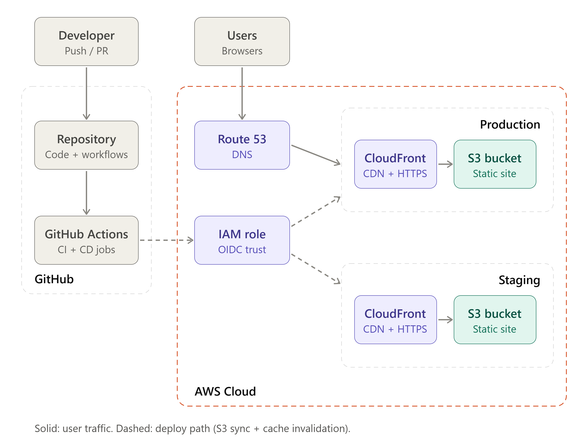


## 1. Project Overview

DevOpsFlow is a web-based dashboard developed to demonstrate the implementation of an automated Continuous Integration and Continuous Deployment (CI/CD) pipeline.

The project integrates modern DevOps tools and practices to automate application testing, code quality checks, security scanning, container image publishing, Kubernetes staging deployment and production deployment.

The frontend is built with React and Vite, while GitHub Actions orchestrates the CI/CD workflow.

### Application Preview

The dashboard provides a visual overview of pipeline stages, deployment environments and deployment history.


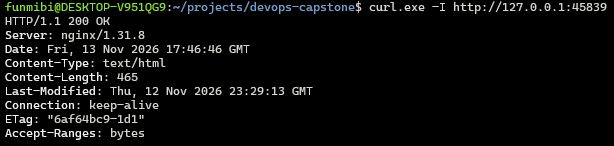

## 2. Technology Stack

| Category | Technology |
|---|---|
| Frontend | React 19 |
| Build Tool | Vite 8 |
| Runtime | Node.js 24 |
| Version Control | Git and GitHub |
| Code Quality | ESLint |
| Unit Testing | Vitest |
| End-to-End Testing | Playwright |
| CI/CD | GitHub Actions |
| Containerisation | Docker |
| Container Registry | GitHub Container Registry |
| Security Scanning | npm audit and Trivy |
| Orchestration | Kubernetes |
| Local Cluster | Minikube |
| Production Hosting | GitHub Pages |

### Development Environment

The project was developed using Node.js, npm, Git and a React development environment.

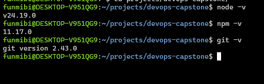

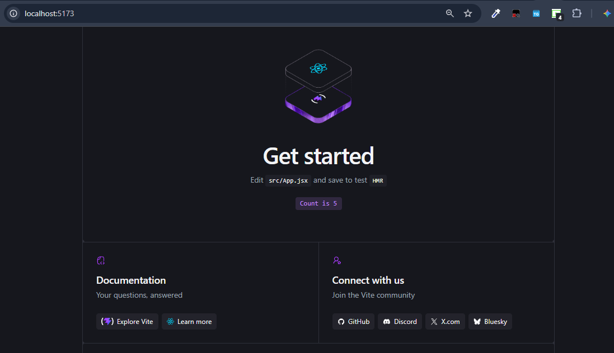

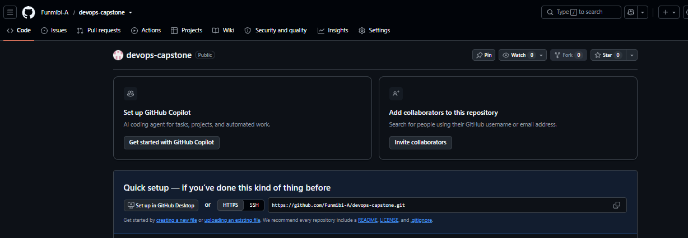

## 3. Application Development

The application was developed using React and Vite. The dashboard presents the CI/CD pipeline stages, environment statuses and deployment history.

Initial development included installing the required dependencies, implementing the dashboard and validating the application build.

### Code Quality

ESLint was configured to identify code quality issues and maintain consistent coding standards.

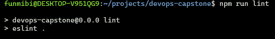

### Dependencies and Production Build

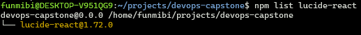

The production build was generated using Vite.

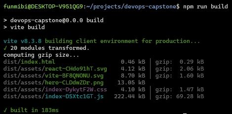

## 4. Continuous Integration and Continuous Deployment

The CI/CD pipeline is implemented using GitHub Actions in:

`.github/workflows/ci.yml`

The workflow runs automatically when code is pushed to the `main` branch or when a pull request targets `main`.

### Pipeline Stages

1. Checkout the source code.
2. Install dependencies using `npm ci`.
3. Audit npm dependencies.
4. Run ESLint.
5. Execute unit tests using Vitest.
6. Run browser-based end-to-end tests using Playwright.
7. Build the production application.
8. Check JavaScript bundle size.
9. Build the Docker image.
10. Scan the container image using Trivy.
11. Publish the image to GitHub Container Registry.
12. Deploy the application to Kubernetes staging.
13. Deploy to GitHub Pages after staging and production approval.

### Automated Workflow

The initial CI workflow was configured to automate application validation and building.

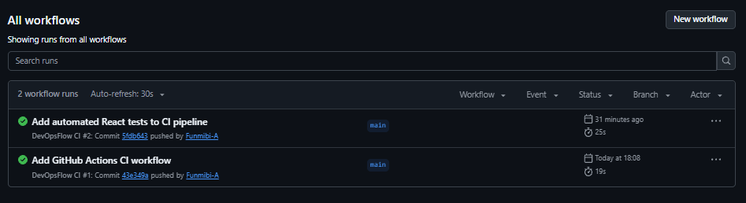

The completed DevOpsFlow workflow integrates testing, container publishing and deployment stages.

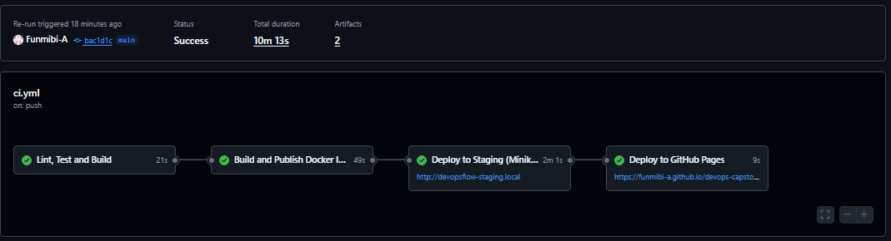

## 5. Automated Testing

Automated testing helps validate the application before deployment.

### Unit Testing

Vitest is used to execute application unit tests.

Run locally:

```bash
npm run test -- --run
```

### End-to-End Testing

Playwright is used to test the application through a browser. The implemented tests cover:

- Dashboard loading.
- Pipeline stages.
- Deployment environment statuses.
- Deployment history.

Run locally:

```bash
npx playwright install chromium
npm run test:e2e
```

The Playwright end-to-end test suite completed successfully.

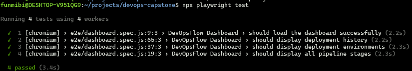

The tests were also integrated into the GitHub Actions workflow.

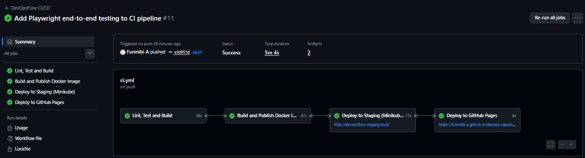

## 6. Security and Pipeline Optimisation

Several measures were introduced to improve application security and workflow reliability.

### Dependency Security Audit

The pipeline uses npm audit to identify vulnerable dependencies.

```bash
npm audit --audit-level=high
```

The CI workflow fails when vulnerabilities at the configured high or critical severity threshold are detected.

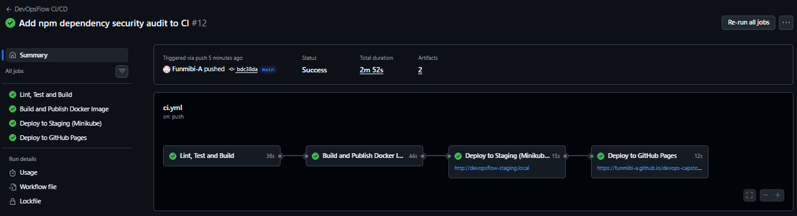

### Workflow Concurrency

Concurrency control was implemented to manage overlapping workflow executions and cancel redundant pull request runs.

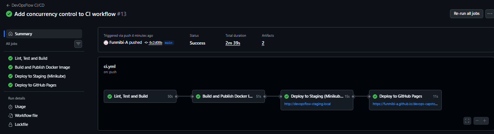

### JavaScript Bundle Size Analysis

A custom Node.js script was developed to calculate compressed JavaScript bundle sizes and enforce a 100 KB budget.

Run locally:

```bash
npm run build
npm run check:bundle
```

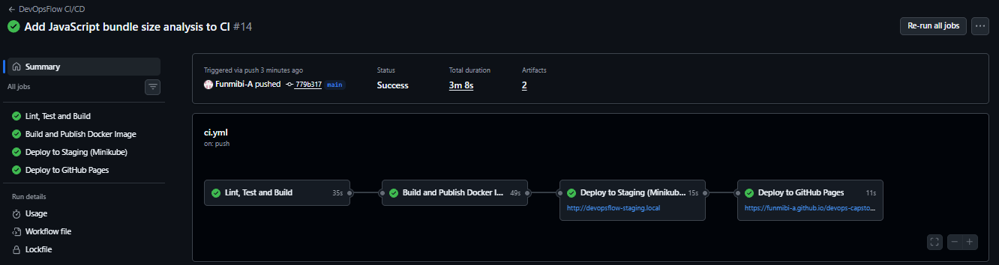

## 7. Docker Containerisation

The application is containerised using Docker and served through Nginx.

The Dockerfile uses an Nginx Alpine base image, applies available Alpine security updates and copies the production build into the Nginx web directory.

### Build the Application

```bash
npm run build
```

### Build the Docker Image

```bash
docker build -t devopsflow:latest .
```

### Run the Container

```bash
docker run -d -p 8080:80 --name devopsflow devopsflow:latest
```

The application can then be accessed at:

`http://localhost:8080`

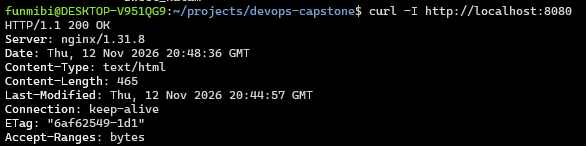

### GitHub Container Registry

The CI/CD pipeline builds and publishes Docker images to GitHub Container Registry (GHCR).

The published image uses the following tags:

```text
ghcr.io/funmibi-a/devopsflow:latest
ghcr.io/funmibi-a/devopsflow:staging
ghcr.io/funmibi-a/devopsflow:sha-<commit-sha>
```

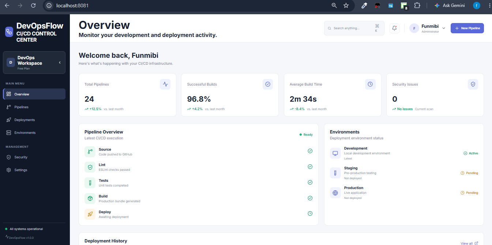

A Docker Compose deployment using the published image was also tested.

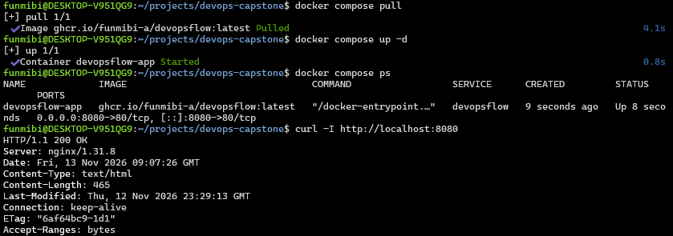

### Container Security Scanning

Trivy is integrated into the CI/CD workflow to scan Docker images for operating system and application library vulnerabilities.

The pipeline is configured to fail when HIGH or CRITICAL vulnerabilities are detected.

## 8. Kubernetes and Minikube

Minikube provides the local Kubernetes environment used for staging deployment.

The Kubernetes configuration is maintained in the `k8s/` directory.

### Minikube Cluster Setup

The Minikube cluster was started and verified before deploying the application.

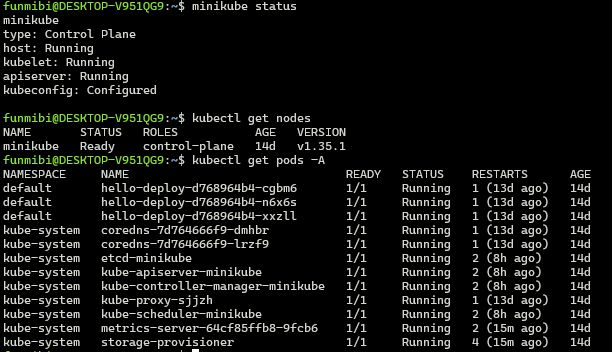

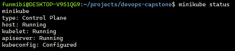

### Ingress Configuration

The Minikube NGINX ingress addon was enabled to provide access to the application through a custom hostname.

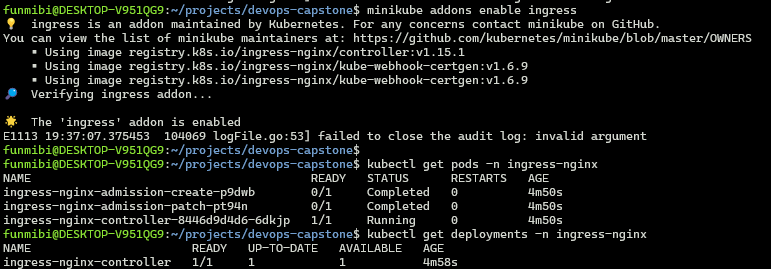

The ingress resource was configured for the DevOpsFlow staging hostname.

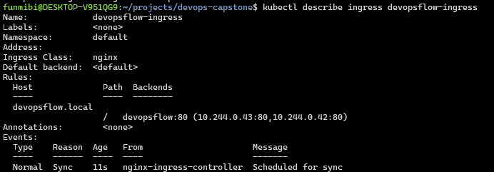

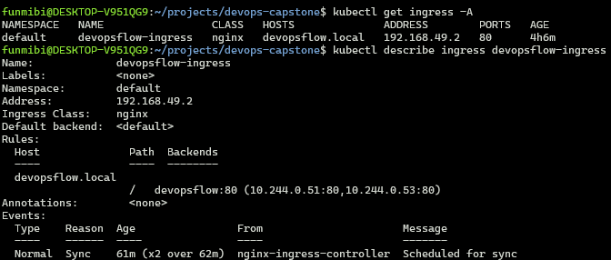

### Kubernetes Resources

The application uses Kubernetes Deployment, Service and Ingress resources.

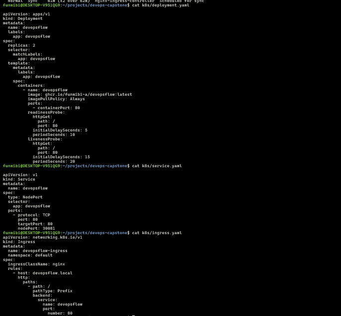

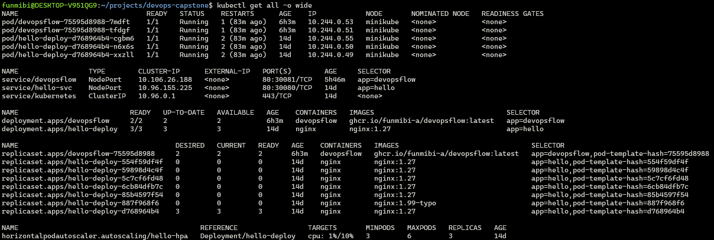

### Deployment and Routing Verification

The cluster and application resources were checked to verify their health.

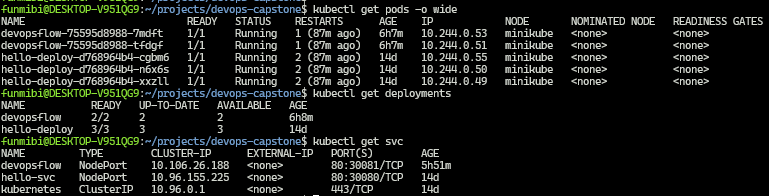

HTTP access was tested through NodePort and Ingress routing.

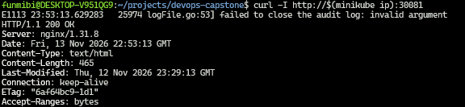

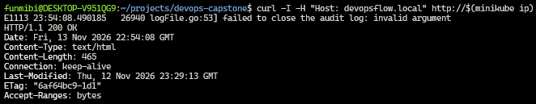

The custom ingress hostname was also configured and tested.

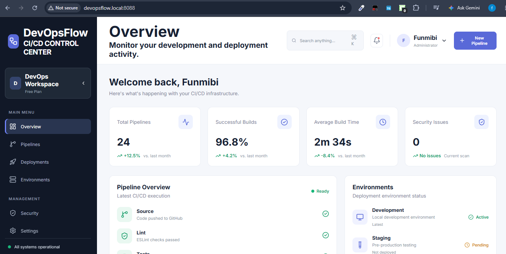

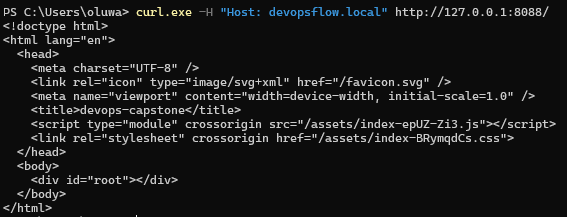

The following diagram illustrates the Kubernetes routing architecture.

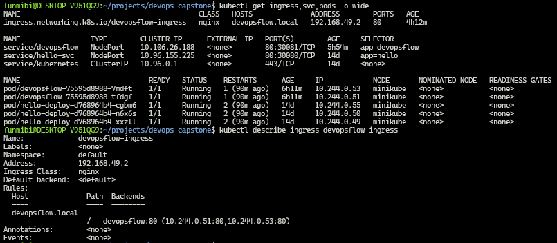

## 9. Automated Staging Deployment

The staging deployment is automated through GitHub Actions using a self-hosted Linux runner connected to the local Minikube cluster.

The workflow applies the staging deployment manifest and verifies the Kubernetes rollout.

The staging deployment is configured with:

- Kubernetes Deployment.
- One application replica.
- Nginx container serving the production build.
- Readiness and liveness probes.
- Staging namespace.
- Automated rollout verification.

The staging hostname is:

`devopsflow-staging.local`

The deployment workflow also performs an HTTP verification after deployment.

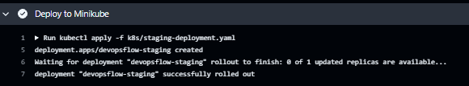

## 10. Production Deployment

Production deployment is handled through GitHub Pages.

The workflow requires the staging deployment to complete successfully before the production deployment job can proceed.

A production environment approval rule was configured to provide a manual approval checkpoint before deployment.

### Production Approval

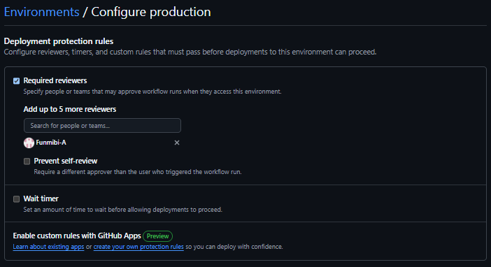

### Production Deployment

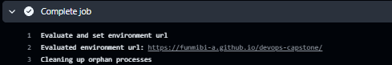

### Live Production Application

The application was successfully deployed and made accessible through GitHub Pages.

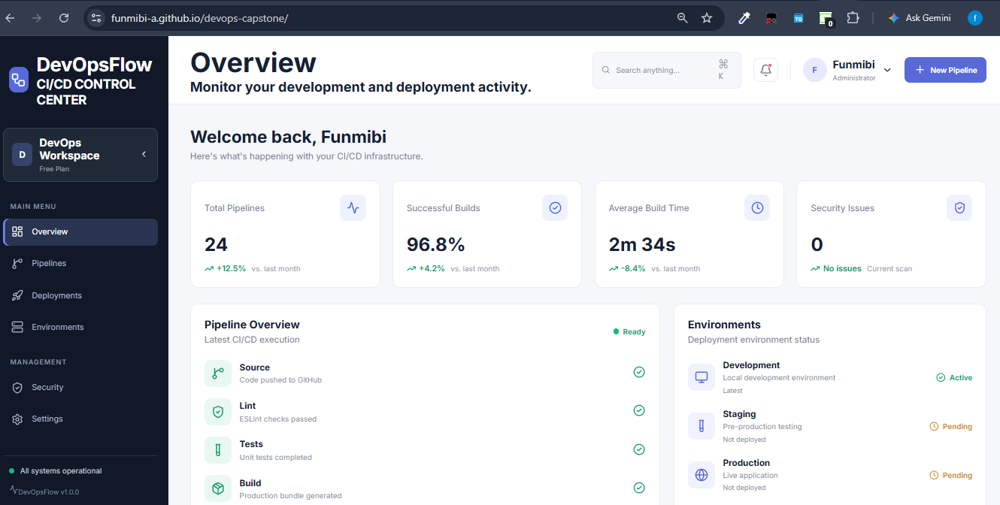

An earlier GitHub Pages deployment was also verified during the project.

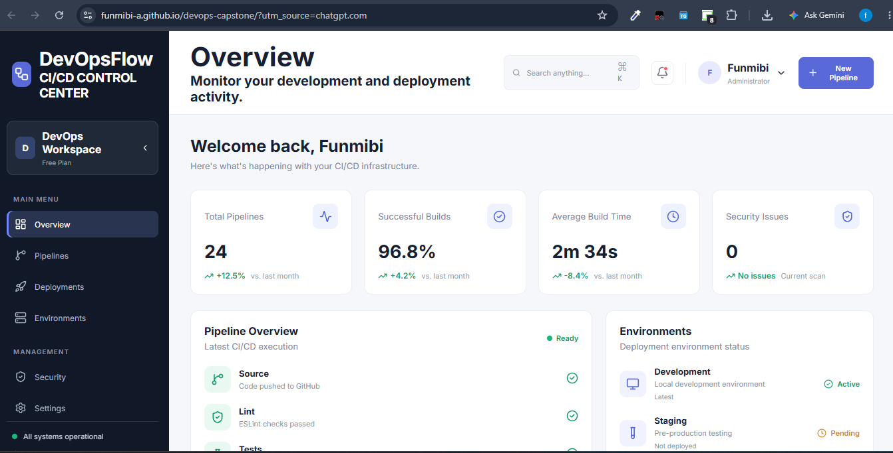

## 11. Getting Started

### Prerequisites

Ensure the following tools are installed:

- Node.js 24 or later.
- npm.
- Git.
- Docker.
- kubectl.
- Minikube for local Kubernetes deployment.

### Clone the Repository

```bash
git clone https://github.com/Funmibi-A/devops-capstone.git
cd devops-capstone
```

### Install Dependencies

```bash
npm ci
```

### Start the Development Server

```bash
npm run dev
```

### Run Code Quality Checks

```bash
npm run lint
```

### Run Unit Tests

```bash
npm run test -- --run
```

### Run End-to-End Tests

```bash
npm run test:e2e
```

### Run Dependency Security Audit

```bash
npm audit --audit-level=high
```

### Build the Application

```bash
npm run build
```

### Check Bundle Size

```bash
npm run check:bundle
```

## 12. Project Structure

```text
devops-capstone/
│
├── .github/
│   └── workflows/
│       └── ci.yml
│
├── e2e/
│   └── dashboard.spec.js
│
├── k8s/
│   ├── deployment.yaml
│   ├── ingress.yaml
│   ├── service.yaml
│   ├── staging-deployment.yaml
│   ├── staging-ingress.yaml
│   └── staging-service.yaml
│
├── screenshots/
│   ├── 01-node-npm-git-versions.png
│   ├── ...
│   └── 35-devopsflow-bundle-size-analysis-success.png
│
├── scripts/
│   └── check-bundle-size.js
│
├── src/
│   ├── App.jsx
│   ├── App.css
│   └── index.css
│
├── Dockerfile
├── package.json
├── package-lock.json
├── playwright.config.js
├── vitest.config.js
└── README.md
```
